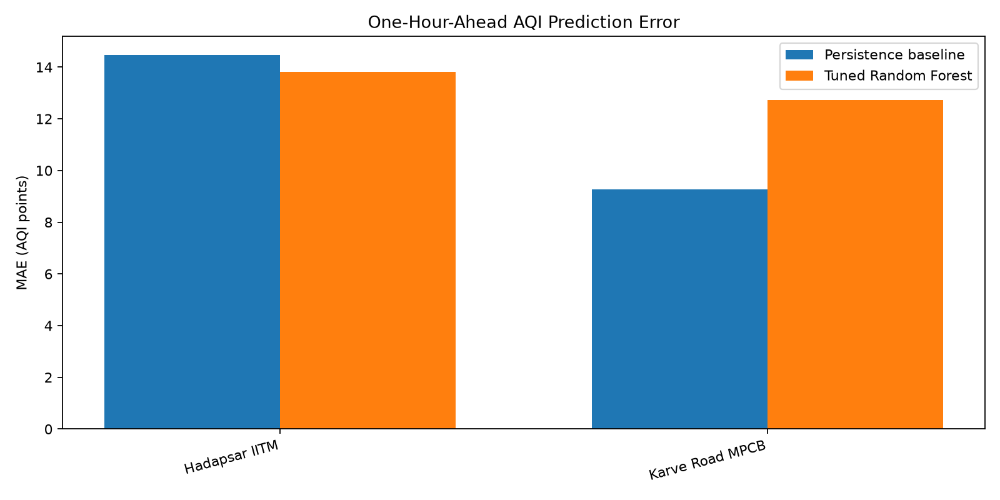

# UrbanPulse
### Real-Time Environmental Analytics & Predictive Decision Support

UrbanPulse is a Python-based environmental analytics project focused on Pune, India. It combines forecast ingestion, PostgreSQL storage, historical station AQI analysis, interactive dashboards, and experimental AQI prediction.

## Features

- Automated weather and air-quality forecast ingestion using Open-Meteo.
- PostgreSQL storage for ingestion runs, historical forecast snapshots, and latest forecasts.
- Exploratory data analysis, summary statistics, correlation analysis, and time-series plots.
- Historical hourly AQI analysis for three Pune monitoring stations.
- Streamlit dashboards for forecast data and historical station trends.
- Experimental Random Forest model evaluated against a persistence baseline.
- Windows Task Scheduler integration for recurring ingestion.

## Technology Stack

Python, Pandas, NumPy, PostgreSQL, scikit-learn, Streamlit, Plotly, Matplotlib, Open-Meteo APIs, PowerShell.

## Project Structure

```text
UrbanPulse/
├── src/                 # Ingestion, analysis, dashboards and models
├── sql/schema.sql       # Database tables and indexes
├── data/                # Local datasets (excluded from Git)
├── models/              # Local model artifacts (excluded from Git)
├── reports/             # Evaluation reports, metrics and plots
├── logs/                # Local execution logs (excluded from Git)
├── .env.example         # Environment configuration template
├── requirements.txt
├── run_scheduled_ingest.ps1
└── README.md
```

## Setup

### Requirements

- Python 3.13 or a compatible Python version
- PostgreSQL
- Git

### 1. Create and activate a virtual environment

```powershell
python -m venv .venv
.\.venv\Scripts\Activate.ps1
```

### 2. Install dependencies

```powershell
python -m pip install -r requirements.txt
```

### 3. Configure the database

Create a PostgreSQL database named `urbanpulse` if it does not already exist. Then apply the schema:

```powershell
& "C:\Program Files\PostgreSQL\18\bin\psql.exe" -U postgres -d urbanpulse -f .\sql\schema.sql
```

Adjust the PostgreSQL executable path if your installation differs.

### 4. Configure environment variables

Copy the example configuration and edit the local file:

```powershell
Copy-Item .env.example .env
notepad .env
```

Set your actual local PostgreSQL credentials in `.env`. Never commit this file.

### 5. Run forecast ingestion

```powershell
python .\src\ingest.py
```

### 6. Launch the dashboards

Forecast dashboard:

```powershell
python -m streamlit run .\src\dashboard.py
```

Historical station dashboard, in another terminal:

```powershell
python -m streamlit run .\src\historical_dashboard.py --server.port 8502
```

## Data Sources and Interpretation

Open-Meteo forecast values are model-based forecasts, not direct sensor measurements. Historical station AQI data is maintained separately from forecast data.

AQI is an index and must not be interpreted as a PM2.5 concentration. Station coverage is uneven, and missing hours affect time-series analysis and model evaluation.

## Experimental Model Evaluation

The current evaluation showed a modest improvement over the persistence baseline for Hadapsar IITM. For Karve Road MPCB, the persistence baseline performed better than the Random Forest model. Bhosari IITM was skipped because valid examples were insufficient for the required chronological splits.

These results are experimental and do not establish production readiness. The data gaps, station metadata, extreme readings, and evaluation design require further validation.

## Reports

The `reports/` directory contains selected evaluation reports, model metrics, prediction plots, summary statistics, and forecast visualizations.

Local datasets and prediction output are excluded from version control by default. Obtain the source datasets separately before running workflows that depend on them.

## Security

- Never commit `.env` or credentials.
- Keep `.env.example` limited to placeholder values.
- Review `git status` and ignored files before pushing to a remote repository.

## Model Evaluation

UrbanPulse evaluates its Random Forest AQI prediction model against a persistence baseline.



The Random Forest model showed a modest improvement at Hadapsar IITM, while the persistence baseline performed better at Karve Road MPCB. These experimental results highlight why predictive models should be evaluated against simple baselines.
